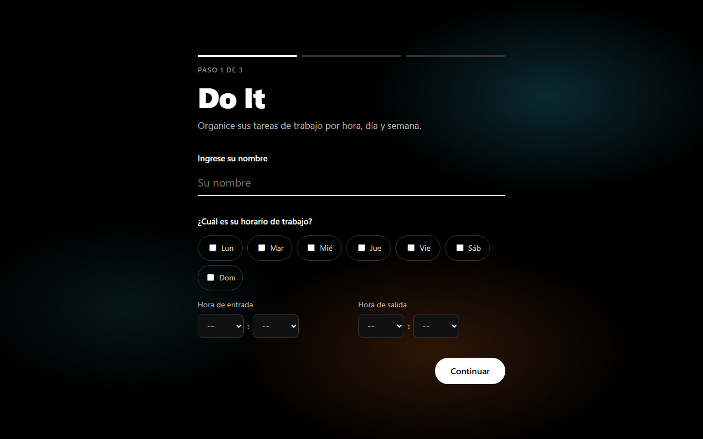
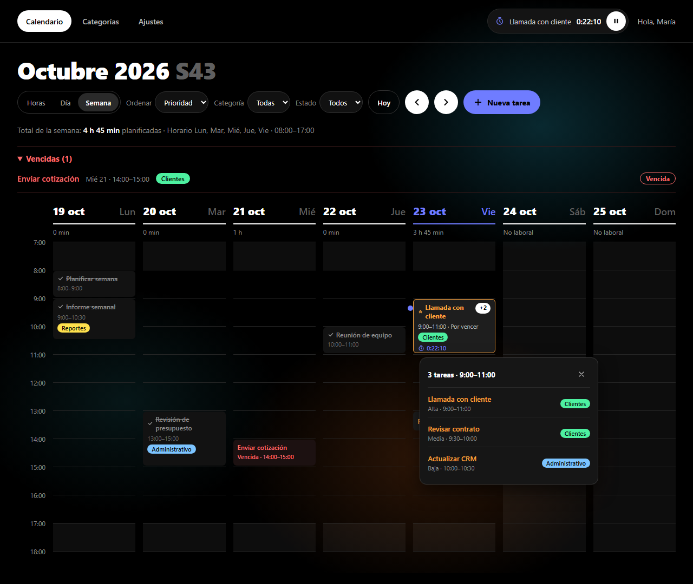
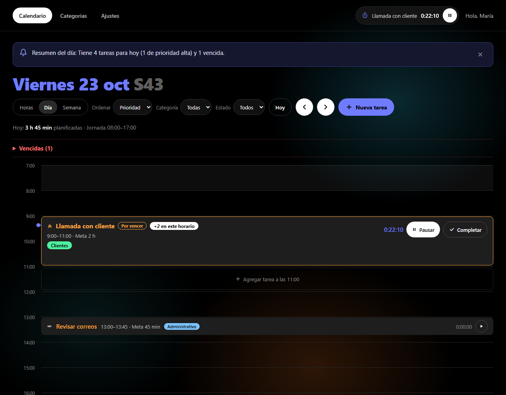
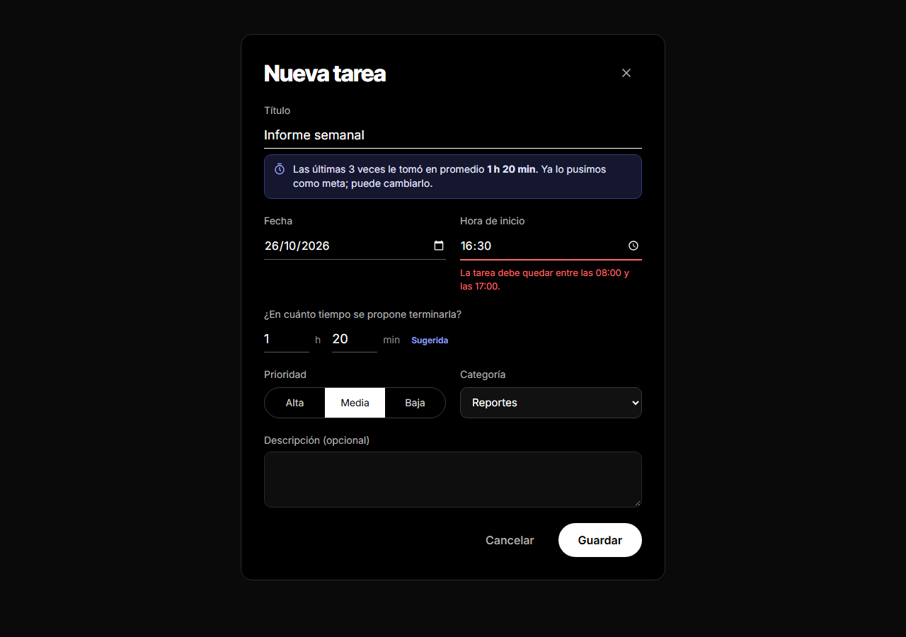

# Propuesta de proyecto — Do It

**Curso:** Programación Intencional con IA Generativa — Universidad CENFOTEC
**Entrega:** Avance 1 (Semana 2) — Propuesta, Arquitectura y Gobierno
**Estudiante:** Fabián Villalta Arburola

---

## 1. Problemática

Las personas que organizan su trabajo con calendarios genéricos enfrentan tres
problemas recurrentes:

1. **Planifican sin medir.** Asignan tiempo a una tarea "a ojo" y nunca
   comparan lo planeado contra lo que realmente tardaron, así que repiten los
   mismos errores de estimación semana a semana.
2. **Los calendarios se saturan visualmente.** Cuando dos tareas comparten
   horario, herramientas como Google Calendar las dibujan en columnas angostas
   lado a lado que se vuelven ilegibles. La clienta reportó este problema
   explícitamente.
3. **Los recordatorios interrumpen.** Una notificación por cada tarea termina
   siendo ruido y se ignora.

## 2. Solución propuesta

**Do It** es una aplicación web de un solo usuario que organiza las tareas
de trabajo en un calendario ajustado al **horario laboral** de la persona, con
tres vistas: **próximas horas**, **día** y **semana**.

| Necesidad | Cómo la resuelve la app |
|---|---|
| Ordenar por tiempo, prioridad y semana | Calendario por horas con vistas Horas / Día / Semana; prioridad visible por color e icono; ordenamiento por prioridad, fecha o meta. |
| Medir cuánto tarda realmente | Cada tarea tiene una **meta de tiempo** y un **cronómetro**. Para tareas repetidas, la app **sugiere la meta** con el promedio de las últimas 3 veces. |
| Calendario limpio | Las tareas que se superponen se agrupan en **un solo bloque** con una insignia "+N"; al pulsarlo se despliega la lista. |
| Recordatorios no invasivos | Hasta **dos recordatorios diarios** a la hora que el usuario elija, cada uno como **un solo resumen** del día. Si no elige hora, no recibe ninguno. |
| Ver lo urgente de un vistazo | Tareas **por vencer** en naranja y **vencidas** en rojo, en una sección siempre visible. |

## 3. Usuario y flujo principal

Persona trabajadora con jornada fija que planifica su semana laboral.

1. **Primer uso:** ingresa su nombre y su horario de trabajo → agrega sus
   primeras tareas (paso opcional) → elige la hora de sus recordatorios.
2. **Uso diario:** abre la vista Día o Próximas horas, inicia el cronómetro de
   la tarea en curso y la marca como completada al terminar.
3. **Planificación:** en la vista Semana revisa la carga de cada día y agrega
   tareas pulsando un espacio libre del calendario.

## 4. Boceto de interfaz (wireframes)

Estilo visual: tema oscuro minimalista, tipografía grande y gruesa, el día de
hoy en azul y categorías como píldoras de color tipo resaltador. Está inspirado
en una referencia aportada por la clienta y adaptado a una cuadrícula por horas.

Las 9 pantallas están en [docs/wireframes/](wireframes/index.html) (PNG y HTML
navegable).

| Primer uso | Calendario · Semana |
|---|---|
|  |  |

| Calendario · Día | Nueva tarea |
|---|---|
|  |  |

## 5. Modelo de datos

Dos entidades relacionadas más las preferencias del usuario, definidas como
interfaces TypeScript en [src/domain/modelo.ts](../src/domain/modelo.ts):

```
Categoria (1) ──── (N) Tarea
Preferencias (única): nombre, horario de trabajo, recordatorios, vista y orden
```

La persistencia es real: todo el estado se guarda en **LocalStorage** y
sobrevive a recargar la página (F5), incluido un cronómetro en marcha.

## 6. Reglas de negocio

La especificación completa está en [requirements.md](../requirements.md), en
sintaxis EARS (`WHEN … IF … THEN system SHALL …`). Contiene 12 reglas de
negocio principales y 40 casos de borde verificables. Las más representativas:

- **RN-01:** no se permiten dos tareas abiertas con el mismo título en la misma
  semana.
- **RN-09:** toda tarea debe quedar dentro del horario de trabajo.
- **RN-10 / RN-11:** solo un cronómetro corre a la vez, y uno olvidado se pausa
  solo al terminar la jornada.
- **RN-08:** las tareas superpuestas se agrupan en un bloque "+N".
- **RN-12:** la meta de una tarea repetida se sugiere con el tiempo real
  medido.

## 7. Arquitectura y gobierno de la IA

- **Stack cerrado:** TypeScript (modo estricto) + Vite, sin frameworks y sin
  dependencias de producción. Solo APIs del navegador.
- **Capas:** `domain` (reglas puras, sin DOM ni almacenamiento) → `storage`
  (LocalStorage) → `services` (casos de uso y planificador de recordatorios) →
  `ui` (DOM).
- **Gobierno:** [.cursorrules](../.cursorrules) obliga a la IA a citar el
  requisito que implementa, a detenerse ante cualquier ambigüedad y le prohíbe
  agregar funcionalidades o parches fuera de la especificación.
  `requirements.md` es la única fuente de verdad y registra en su historial
  cada cambio pedido por la clienta.

## 8. Alcance y limitaciones

**Fuera de alcance:** cuentas o login, backend, vista de mes, arrastrar
tareas, tareas recurrentes automáticas y tareas sin fecha.

**Limitación aceptada:** sin servidor, el navegador no puede mostrar
notificaciones con la app cerrada. Para cubrirlo, al abrir la app se muestra el
resumen que se perdió (RN-03).

## 9. Plan de trabajo

| Semana | Entregable |
|---|---|
| 2 (actual) | Esta propuesta, wireframes, modelo de datos, `requirements.md` y `.cursorrules`. |
| 3 | Generación del código guiada por la especificación: persistencia completa, reglas RN-01 a RN-12 y pruebas automáticas de cada regla y caso de borde. |
| 4 | Pulido de la interfaz, `REFLECTION.md` y defensa en vivo. |
